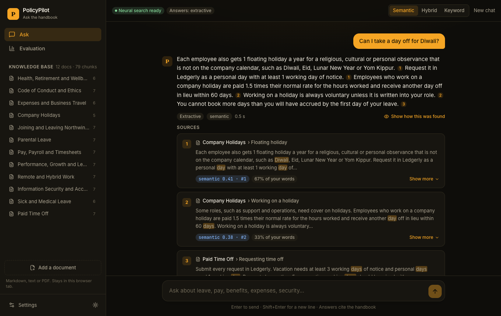
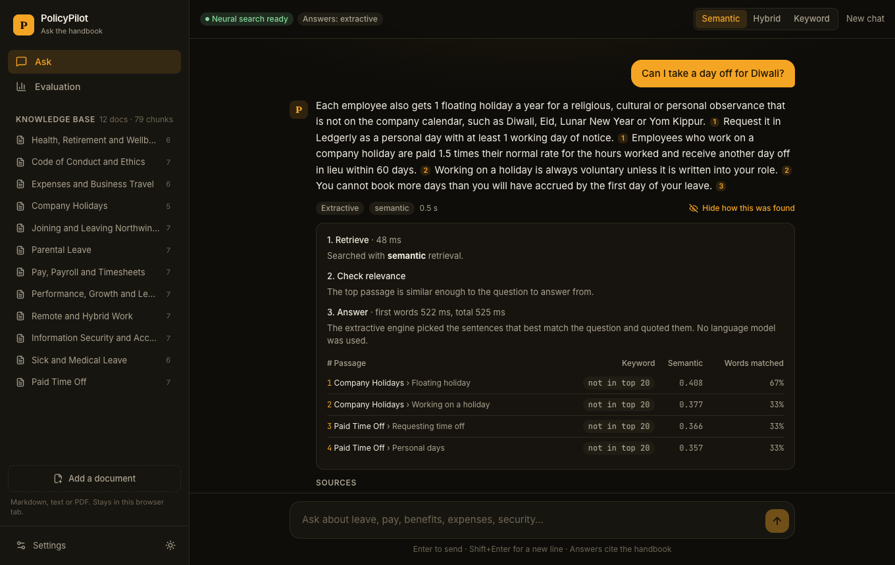
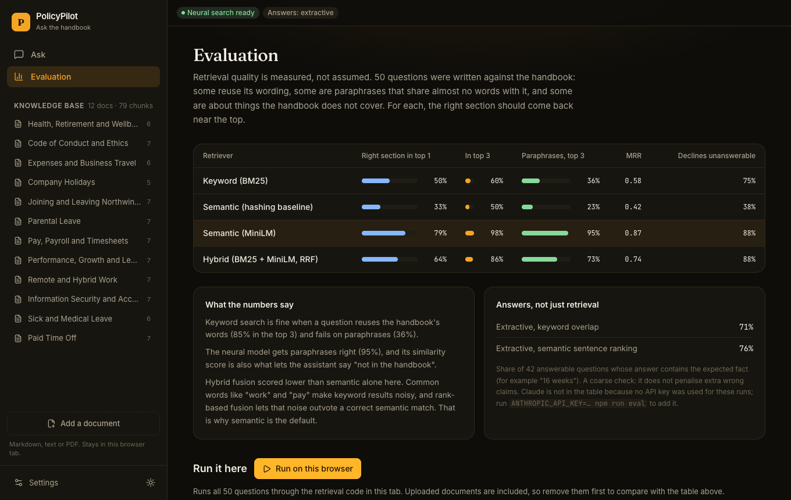
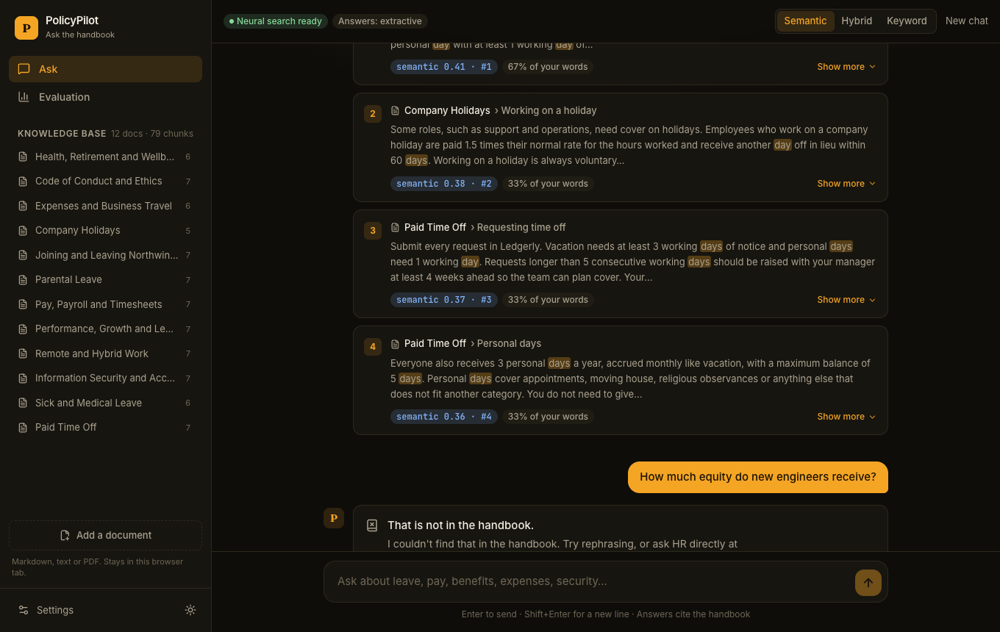
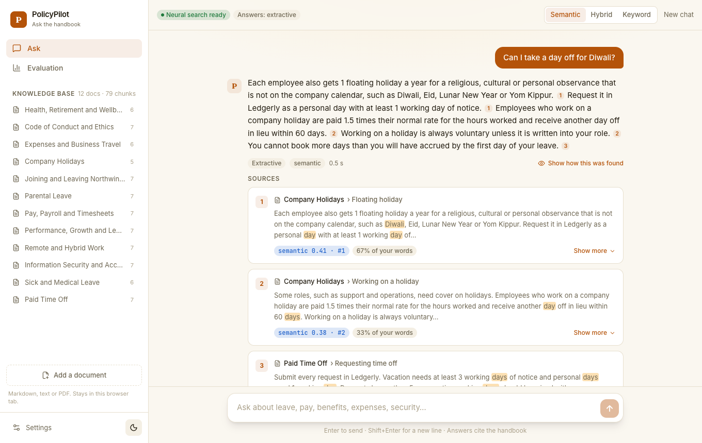
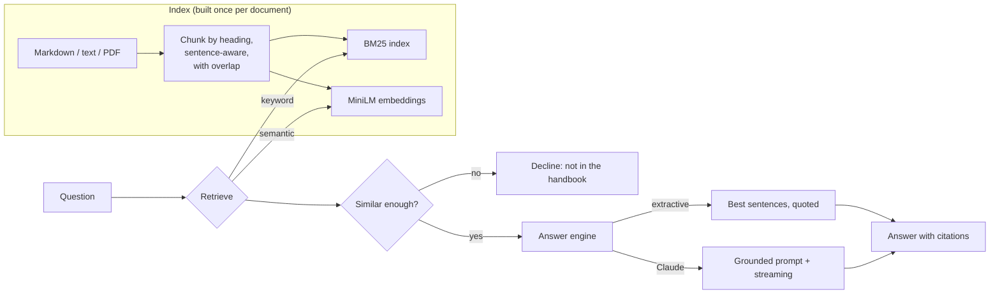

# PolicyPilot

Ask an HR handbook questions in your own words and get an answer that cites the passages it came from. When the handbook does not cover the question, it says so instead of guessing.

This is a retrieval-augmented generation (RAG) assistant built end to end: chunking, keyword and neural search, a grounded answer step with citations, an evaluation harness, and a React front end. A small embedding model runs **in the browser**, so the live demo has no server and no API key.

**[Try the live demo →](https://duelboy03.github.io/policy-pilot/)** The first visit downloads a 23 MB search model (about a minute on a slow connection, instant after that, and the app works with keyword search while it loads).



<table>
<tr>
<td></td>
<td></td>
</tr>
<tr>
<td></td>
<td></td>
</tr>
</table>

## What it does

- **Cited answers.** Every claim carries a number that links to the source passage, with the words that matched your question highlighted.
- **Says "not in the handbook".** If no passage is similar enough, the assistant declines and does not call a language model at all.
- **Understands paraphrases.** "Can I take a day off for Diwali?" finds the floating holiday; "Am I allowed to paste customer data into ChatGPT?" finds the AI-tools policy.
- **Shows its work.** A "how this was found" panel lists each retrieval step, timings, and the keyword and semantic score of every passage.
- **Bring your own documents.** Upload Markdown, text or PDF, or paste text. It is chunked, embedded and searchable at once.
- **Two answer engines.** Extractive (quotes the best sentences, no AI model) works offline. Paste an Anthropic API key and Claude writes the answer from the same passages.
- **Evaluation built in.** 50 questions with known answers, with results shown in the app and re-runnable in your browser.

## How it works



| Package | What is in it |
| --- | --- |
| `packages/core` | The whole pipeline as TypeScript with no framework: chunker, tokenizer and stemmer, BM25, embeddings, vector search, rank fusion, answer engines, evaluation. Runs in Node and the browser. |
| `apps/web` | React app. Talks to an `Engine` interface with two implementations: in-browser, or HTTP to the server. |
| `apps/server` | Express API with server-sent-event streaming, file upload and rate limiting. Holds the model and any API key. |

### Choices worth explaining

- **Chunks keep their context.** Documents are split at headings, then on sentence boundaries up to about 130 words with one sentence of overlap. Each chunk is embedded together with its document title and heading path, so a paragraph that says only "50 percent, up to 6 percent of your pay" still knows it belongs to *401(k) retirement plan*.
- **The model is local.** `all-MiniLM-L6-v2` (384 dimensions, 8-bit quantised) runs through Transformers.js: ONNX Runtime in Node, WebAssembly in the browser. The bundled handbook's embeddings are precomputed, so only your questions and uploads are embedded at run time.
- **Declining is a feature.** Relevance is the best passage's cosine similarity against a floor calibrated on the evaluation set. Below it, no model is called, which saves money and removes the chance of an invented answer.
- **The prompt treats sources as data.** The system prompt tells the model to use only the numbered sources, cite every claim, quote numbers exactly, and ignore any instructions found inside a source, which matters once users can upload documents.
- **The API key never leaves the tab.** In the browser it is held in memory only, never written to storage, and sent straight to `api.anthropic.com`. For anything shared, use the server, which keeps the key in an environment variable.

## Measured results

`npm run eval` runs 50 questions against the handbook: 20 that reuse its wording, 22 paraphrases that share almost no words with it, and 8 about things it does not cover. A retrieval is a hit if the section that holds the answer is among the top results.

| Retriever | Hit@1 | Hit@3 | Paraphrases, Hit@3 | MRR | Declines unanswerable | Wrongly declines |
| --- | --- | --- | --- | --- | --- | --- |
| Keyword (BM25) | 50% | 60% | 36% | 0.58 | 75% | 19% |
| Semantic, hashing baseline | 33% | 50% | 23% | 0.42 | 38% | 24% |
| **Semantic, MiniLM** (default) | **79%** | **98%** | **95%** | **0.87** | 88% | 2% |
| Hybrid (BM25 + MiniLM, RRF) | 64% | 86% | 73% | 0.74 | 88% | 5% |

Answer level, with the retrieval above (does the answer contain the expected fact, such as "16 weeks"?):

| Answer engine | Fact present |
| --- | --- |
| Extractive, keyword overlap | 71% (30/42) |
| Extractive, semantic sentence ranking (default) | 76% (32/42) |
| Claude | not measured here: run `ANTHROPIC_API_KEY=... npm run eval` to add it |

What I learned from these numbers, including the parts that did not go the way I expected:

1. **Hybrid search was worse than semantic alone on this corpus.** I built BM25 and reciprocal rank fusion expecting hybrid to win. It lost 12 points at Hit@3, because common words such as "work" and "pay" make BM25's top results noisy, and rank-based fusion lets that noise outvote a correct semantic match. I tried weighted fusion, score-level fusion and pruning common query words; none beat semantic alone, so semantic is the default and hybrid stays as an option. Hybrid should do better on corpora full of exact identifiers (policy numbers, product codes), which this one is not.
2. **One unanswerable question still gets answered.** "What is the dress code?" scores 0.45 against the remote-work section ("How we work"), above the 0.32 floor. A single similarity threshold cannot separate every near miss.
3. **The extractive engine is a fallback, not a chatbot.** It picks the right facts 76% of the time but cannot reason or merge sources, and it sometimes quotes a neighbouring sentence. That is the reason the Claude path exists.
4. The evaluation set is small and written by the same person who wrote the handbook, so treat the percentages as indicative.

## Run it

```bash
npm install
npm run dev:demo      # everything in the browser, http://localhost:5173
npm run dev           # Express API on :4100 plus the web app
```

With the server, set `ANTHROPIC_API_KEY` (see `.env.example`) to have Claude write the answers.

| Command | What it does |
| --- | --- |
| `npm test` / `npm run coverage` | Unit and API tests (Vitest) |
| `npm run test:e2e` | Browser tests (Playwright, installed Chrome) |
| `npm run eval` | Retrieval and answer evaluation, writes `packages/core/eval/results.json` |
| `npm run build:index` | Re-chunk and re-embed `packages/core/data/handbook/*.md` (a test fails when the committed index is stale) |

### API

| Endpoint | |
| --- | --- |
| `POST /api/ask` | `{ question, mode?, k? }` streams server-sent events: `sources`, `token`…, `done` |
| `POST /api/search` | Retrieval only, with per-retriever scores |
| `GET /api/docs`, `POST /api/docs`, `DELETE /api/docs/:id` | List, upload (`.md`, `.txt`, `.pdf` up to 2 MB, or JSON text) and remove documents |

## Testing

**63 unit and API tests (about 95% statement coverage) and 12 browser tests.**

- **Core:** tokenizer and stemmer conflation, BM25 ranking, chunk boundaries and overlap (including that nothing is lost and decimals like "1.67" are not split), rank fusion maths, vector search, the knowledge base (modes, fallbacks, removal, state round trip, vector reuse), answer engines, and the evaluation metrics themselves.
- **Claude client against a mocked API:** request headers and body, streaming deltas split across network chunks, API errors, mid-stream errors.
- **A guard test** fails if the committed index no longer matches the handbook files.
- **Server:** streaming order, declining without calling the model, validation, rate limiting, upload limits and types, and that built-in documents cannot be deleted.
- **Browser:** asking and citing, declining, retrieval modes and the inspector, Markdown and PDF upload, pasted text, bad uploads, the Claude path with a mocked API (and that the key is not persisted), a failing Claude call, and the in-browser evaluation run.

## Limits

- The handbook is fictional and small (12 documents, 79 chunks). Brute-force vector search is fine at this size; a real deployment would use an index.
- PDFs need selectable text. Scanned PDFs need OCR first.
- Answers can only be as good as the passages retrieved. The inspector exists so that a wrong answer can be traced to the step that failed.

## Stack

React 19 · TypeScript · Vite · Tailwind CSS 4 · Transformers.js (ONNX) · pdf.js · Express 5 · Anthropic Messages API · Vitest · Playwright · GitHub Actions

## License

MIT
